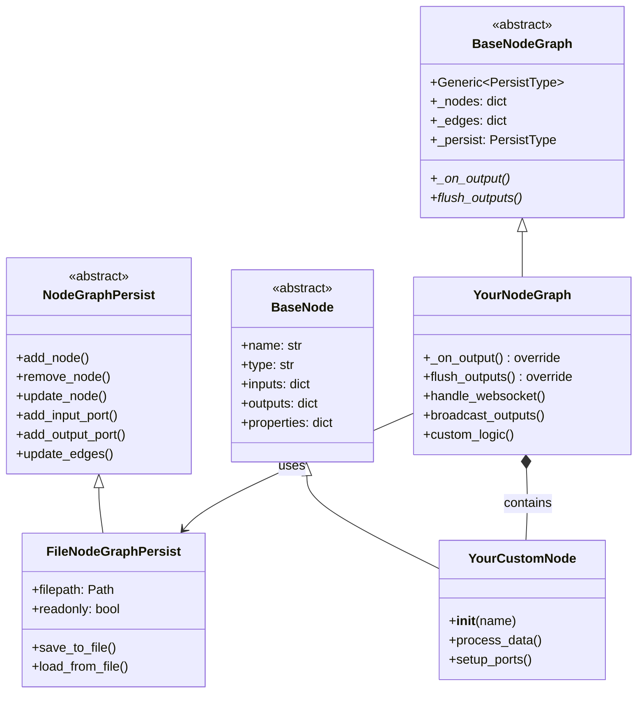
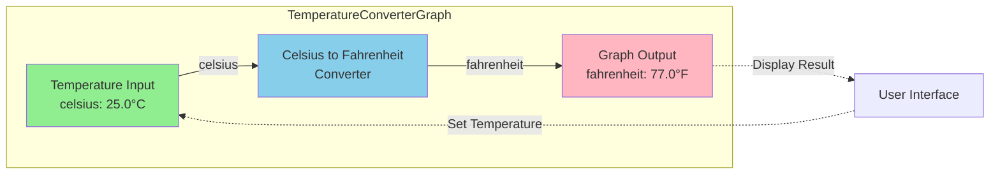

# Building Data Flow Applications with nonoha-core

## Overview

This guide demonstrates how to build data flow applications by extending the base classes from nonoha-core: `BaseNode`, `BaseNodeGraph`, and `NodeGraphPersist`. We'll use the nonoha-engine implementation as a reference.

## Architecture Overview



## Step-by-Step Implementation Guide

### 1. Create Your Persist Implementation

First, implement the `NodeGraphPersist` abstract class to handle saving/loading:

```python
from nonoha_core import NodeGraphPersist
from pathlib import Path
import json

class FileNodeGraphPersist(NodeGraphPersist):
    def __init__(self, filepath: Path, readonly: bool = False):
        super().__init__()
        self.filepath = filepath
        self.readonly = readonly
        self._data = self._load_data()
    
    def add_node(self, node_name: str, node_type: str) -> None:
        if self.readonly:
            return
        self._data["nodes"][node_name] = {"type": node_type}
        self._save_data()
    
    def remove_node(self, node_name: str) -> None:
        if self.readonly:
            return
        self._data["nodes"].pop(node_name, None)
        self._save_data()
    
    def update_edges(self, edges: dict) -> None:
        if self.readonly:
            return
        self._data["edges"] = edges
        self._save_data()
    
    def _save_data(self):
        with open(self.filepath, 'w') as f:
            json.dump(self._data, f, indent=2)
    
    def _load_data(self):
        if self.filepath.exists():
            with open(self.filepath, 'r') as f:
                return json.load(f)
        return {"nodes": {}, "edges": {}, "properties": {}}
```

### 2. Create Your Custom Nodes

Extend `BaseNode` to create custom processing nodes:

```python
from nonoha_core import BaseNode, StaticTypeInputPort, StaticTypeOutputPort
from nonoha_core import PortValueType, DataType
import numpy as np

class MathAddNode(BaseNode):
    def __init__(self, name: str):
        super().__init__(name, "MathAdd")
        
        # Define input/output types
        in_types = [PortValueType(DataType.Float32), PortValueType(DataType.Float32)]
        out_type = PortValueType(DataType.Float32)
        
        # Create input port that accepts multiple values
        input_values = StaticTypeInputPort("values", in_types)
        input_values.subscribe(id(self), self._on_input_values)
        
        # Create output port
        output_value = StaticTypeOutputPort("value", [out_type])
        
        # Store references
        self._input_values = input_values
        self._output_value = output_value
        
        # Register ports
        self.inputs[input_values.name] = input_values
        self.outputs[output_value.name] = output_value
    
    def _on_input_values(self, values: list):
        try:
            # Perform addition on all input values
            result = values[0]
            for value in values[1:]:
                result = np.add(result, value)
        except Exception as e:
            print(f"{self.name}: Error while adding numbers: {e}")
            return
        
        # Dispatch result
        self._output_value.dispatch([result])
```

### 3. Create Your Node Graph

Extend `BaseNodeGraph` with your persist type. **Important**: You must implement the `_on_output()` and `flush_outputs()` methods:

```python
from nonoha_core import BaseNodeGraph, StaticTypeOutputPort
from typing import Optional
import asyncio
import json

class MyNodeGraph(BaseNodeGraph[FileNodeGraphPersist]):
    def __init__(self, name: str, persist: FileNodeGraphPersist):
        super().__init__(name, "MyNodeGraph", persist)
        self._output_buffer = {}
        self._websocket_clients = []
    
    def _on_output(self, port: StaticTypeOutputPort, values: list):
        """Override: Handle output from nodes (required implementation)"""
        # Buffer the output values for later broadcasting
        port_name = port.name
        # Convert numpy arrays to lists for JSON serialization
        serializable_values = []
        for value in values:
            if hasattr(value, 'tolist'):
                serializable_values.append(value.tolist())
            else:
                serializable_values.append(value)
        
        self._output_buffer[port_name] = serializable_values
    
    def flush_outputs(self):
        """Override: Send buffered outputs (required implementation)"""
        # Broadcast buffered outputs to all WebSocket clients
        if self._output_buffer:
            for client in self._websocket_clients:
                # Note: In async context, you'd use await client.send_json()
                try:
                    client.send(json.dumps(self._output_buffer))
                except Exception as e:
                    print(f"Failed to send to client: {e}")
            self._output_buffer.clear()
    
    async def handle_websocket_event(self, event: dict):
        """Handle incoming WebSocket messages"""
        if event["type"] == "input":
            port_name = event["port"]
            value = event["value"]
            
            # Send value to graph input port
            if port_name in self.inputs:
                self.inputs[port_name].dispatch(
                    [np.array(value)]
                )
                
                # Process and broadcast outputs
                self.flush_outputs()
```

#### Required Method Implementations

When inheriting from `BaseNodeGraph`, you **must** implement these two methods:

1. **`_on_output(self, port: StaticTypeOutputPort, values: list)`**:
   - Called automatically when any node in the graph produces output
   - Use this to handle/buffer output values from nodes
   - The `port` parameter is the output port that sent the data
   - The `values` parameter contains the output data

2. **`flush_outputs(self)`**:
   - Called to send buffered output data to external systems
   - Implement logic to broadcast, save, or transmit the buffered outputs
   - Clear buffers after sending to prevent duplicate sends

### 4. Use the Built-in Node Registry

nonoha-core provides a built-in `NodeRegistry` class for managing node types:

```python
from nonoha_core.node_registry import NodeRegistry

# Create registry instance
registry = NodeRegistry()

# Register your custom nodes
registry.register_node("MathAdd", MathAddNode)
registry.register_node("TemperatureInput", TemperatureInputNode)
registry.register_node("CelsiusToFahrenheit", CelsiusToFahrenheitNode)

# Register built-in nodes (optional - they're usually auto-registered)
from nonoha_core.nodes import arithmetic_operation_nodes
registry.register_node("Add", arithmetic_operation_nodes.AddNode)
registry.register_node("Subtract", arithmetic_operation_nodes.SubtractNode)

# Create nodes using the registry
node = registry.create_node("MathAdd", "my_add_node")
```

#### Plugin System Support

You can also create plugins with the registry:

```python
# In your plugin's __init__.py
def register_nodes(registry: NodeRegistry):
    """Plugin registration function"""
    registry.register_node("MyCustomNode", MyCustomNode)
    registry.register_node("AnotherNode", AnotherNode)
```

### 5. Create the Application Manager

Build a top-level manager to handle multiple graphs:

```python
from pathlib import Path

class DataFlowApp:
    def __init__(self, registry: NodeRegistry):
        self.registry = registry
        self.graphs = {}
    
    def load_graph(self, filepath: Path) -> MyNodeGraph:
        """Load a node graph from file"""
        persist = FileNodeGraphPersist(filepath)
        graph = MyNodeGraph(filepath.stem, persist)
        
        # Load nodes
        for node_name, node_data in persist._data["nodes"].items():
            node = self.registry.create_node(
                node_data["type"], node_name
            )
            graph.add_node(node)
        
        # Load connections
        for edge_key, edge_data in persist._data["edges"].items():
            graph.connect_nodes(
                edge_data["output_node"],
                edge_data["output_port"],
                edge_data["input_node"],
                edge_data["input_port"]
            )
        
        self.graphs[filepath.stem] = graph
        return graph
    
    async def run(self):
        """Main application loop"""
        # Setup WebSocket server
        # Process incoming connections
        # Handle graph events
        pass
```

## Complete Example: Temperature Converter

Here's a complete example that converts temperature between units:

```python
# temperature_converter.py
from nonoha_core import BaseNode, StaticTypeInputPort, StaticTypeOutputPort
from nonoha_core import PortValueType, DataType
import numpy as np

class TemperatureInputNode(BaseNode):
    def __init__(self, name: str):
        super().__init__(name, "TemperatureInput")
        
        # Output port for temperature value
        self.outputs["celsius"] = StaticTypeOutputPort(
            "celsius", [PortValueType(DataType.Float32)]
        )
        
        # Property to store temperature
        self.properties["temperature"] = 0.0
    
    def set_temperature(self, temp: float):
        self.properties["temperature"] = temp
        self.outputs["celsius"].dispatch(
            [np.array([temp], dtype=np.float32)]
        )

class CelsiusToFahrenheitNode(BaseNode):
    def __init__(self, name: str):
        super().__init__(name, "CelsiusToFahrenheit")
        
        # Create input port
        input_celsius = StaticTypeInputPort(
            "celsius", [PortValueType(DataType.Float32)]
        )
        input_celsius.subscribe(id(self), self._on_celsius_change)
        
        # Create output port
        output_fahrenheit = StaticTypeOutputPort(
            "fahrenheit", [PortValueType(DataType.Float32)]
        )
        
        # Store references
        self._input_celsius = input_celsius
        self._output_fahrenheit = output_fahrenheit
        
        # Register ports
        self.inputs[input_celsius.name] = input_celsius
        self.outputs[output_fahrenheit.name] = output_fahrenheit
    
    def _on_celsius_change(self, values: list):
        try:
            celsius = values[0][0]  # Get the first value
            fahrenheit = (celsius * 9/5) + 32
            self._output_fahrenheit.dispatch(
                [np.array([fahrenheit], dtype=np.float32)]
            )
        except Exception as e:
            print(f"{self.name}: Error converting temperature: {e}")

# Create and wire the graph
def create_temperature_graph():
    # Create persist and graph
    persist = FileNodeGraphPersist(Path("temp_converter.json"))
    graph = MyNodeGraph("TemperatureConverter", persist)
    
    # Create nodes
    input_node = TemperatureInputNode("temp_input")
    converter_node = CelsiusToFahrenheitNode("converter")
    
    # Add to graph
    graph.add_node(input_node)
    graph.add_node(converter_node)
    
    # Connect nodes
    graph.connect_nodes(
        output_node="temp_input",
        output_port="celsius",
        input_node="converter",
        input_port="celsius"
    )
    
    # Connect converter output to graph output
    graph.add_output_port("fahrenheit", 
        [PortValueType(DataType.Float32)])
    graph.connect_node_to_output(
        "converter", "fahrenheit", "fahrenheit"
    )
    
    return graph

# Usage
graph = create_temperature_graph()
graph.get_node("temp_input").set_temperature(25.0)
# Output will be available at graph.outputs["fahrenheit"]
```

## Data Flow Diagram



## Best Practices

1. **Node Design**:
   - Keep nodes focused on a single responsibility
   - Use descriptive names for ports
   - Validate input types in callbacks
   - Handle edge cases gracefully

2. **Graph Organization**:
   - Group related nodes into subgraphs
   - Use clear naming conventions
   - Document complex connections
   - Consider performance for large graphs

3. **Persistence**:
   - Version your graph format
   - Handle backward compatibility
   - Validate data on load
   - Consider using compression for large graphs

4. **Error Handling**:
   - Catch exceptions in node callbacks
   - Provide meaningful error messages
   - Log errors for debugging
   - Gracefully handle missing connections

5. **Testing**:
   - Unit test individual nodes
   - Test graph connectivity
   - Verify data type compatibility
   - Test persistence round-trips

## Advanced Features

### Dynamic Port Creation

```python
class DynamicNode(BaseNode):
    def add_input(self, port_name: str, port_type: PortValueType):
        """Dynamically add an input port"""
        self.inputs[port_name] = StaticTypeInputPort(
            port_name, [port_type]
        )
        self.inputs[port_name].subscribe_data_dispatch(
            self._on_dynamic_input
        )
        
        # Notify persist layer
        if self.parent_graph:
            self.parent_graph._persist.add_input_port(
                self.name, port_name, [port_type]
            )
```

### Custom Properties UI

```python
class ConfigurableNode(BaseNode):
    def __init__(self, name: str):
        super().__init__(name, "Configurable")
        
        # Define property schema for UI
        self.property_schema = {
            "threshold": {
                "type": "number",
                "min": 0,
                "max": 100,
                "default": 50
            },
            "mode": {
                "type": "enum",
                "options": ["fast", "accurate"],
                "default": "fast"
            }
        }
```

### Real-time Collaboration

```python
class CollaborativeGraph(MyNodeGraph):
    async def broadcast_change(self, change_event: dict):
        """Broadcast graph changes to all connected clients"""
        for client in self._websocket_clients:
            await client.send_json({
                "type": "graph_change",
                "change": change_event
            })
```

## Conclusion

Building data flow applications with nonoha-core provides a flexible, extensible architecture for visual programming. By extending the base classes and following the patterns shown in this guide, you can create powerful node-based applications for any domain.
