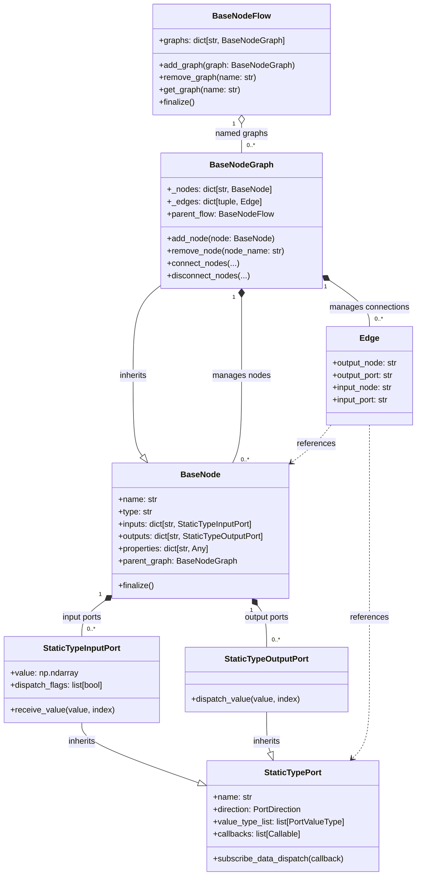
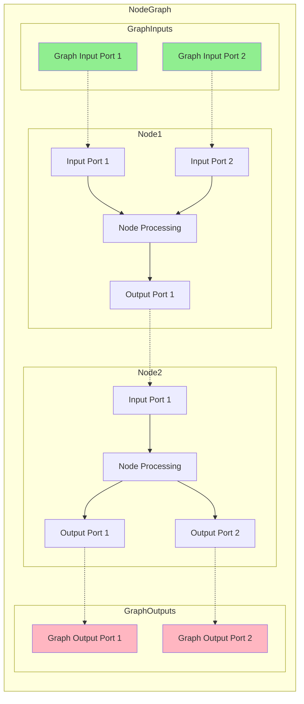

# NodeFlow, NodeGraph, Node, Port Architecture Relationship Diagram

## Overview

The nonoha-core visual programming system consists of four main components: **NodeFlow**, **NodeGraph**, **Node**, and **Port**.

## Architecture Diagram



## Data Flow Diagram



## Component Relationships

### 1. **NodeFlow**
- A named collection of graphs — the container level above the graph
- Graphs added to a flow receive a `parent_flow` back-reference (the flow-level counterpart of a node's parent-graph reference), making the flow the resolution scope for graph-to-graph references
- Holds only the in-memory collection and its lifecycle

### 2. **NodeGraph**
- Functions as a container for nodes
- Manages connections (edges) between nodes
- The graph itself behaves as a node (has input/output ports)
- Controls adding, removing, connecting, and disconnecting nodes
- Has a reference to its parent flow (when it belongs to one)

### 3. **Node**
- Basic unit of data processing
- Has input and output ports
- Maintains node-specific settings through properties
- Has a reference to its parent graph

### 4. **Port**
- Data input/output interface
- Has type information (PortValueType)
- Propagates data through callback mechanism
- Input Port: Receives data
- Output Port: Sends data

## Connection Mechanism

```python
# Node-to-node connection
graph.connect_nodes(
    output_node="Node1",
    output_port="output",
    input_node="Node2", 
    input_port="input"
)

# Graph input to node connection
graph.connect_input_to_node(
    graph_input_port="graph_input",
    node="Node1",
    node_input_port="input"
)

# Node to graph output connection
graph.connect_node_to_output(
    node="Node2",
    node_output_port="output",
    graph_output_port="graph_output"
)
```

## Data Flow Process

1. **Input**: Values enter from graph input ports or other nodes' output ports
2. **Receive**: Input ports receive values through `receive_value`
3. **Process**: Nodes process values through callbacks
4. **Send**: Output ports send values through `dispatch_value`
5. **Propagate**: Values are transmitted to the next connected ports

## Type System

- `PortValueType`: Defines port data types and multidimensional shapes
- **Shape System**: Supports scalar, 1D, 2D, and N-dimensional arrays with type safety
  - `PortValueType(DataType.Float32)` → `"f32"` (scalar)
  - `PortValueType(DataType.Float32, (3,))` → `"f32[3]"` (1D array)
  - `PortValueType(DataType.Float32, (3, 2))` → `"f32[3x2]"` (2D matrix)
  - Variable dimensions: `(-1,)` means "any size"
- **Dispatch Flags**: Control when input ports trigger callbacks
  - `dispatch_flags: list[bool]` per input port
  - Enables selective triggering for advanced control flow
- Type compatibility is checked during connection (`port_is_connectable`)
- Values are handled as NumPy arrays
- Supports flexible connections with "Any" type

> **📚 For detailed specification**: See [Port System Specification](port-system-specification.md)

## Persistence

- `NodeGraphPersist` interface abstracts persistence
- `FileNodeGraphPersist` implements file save/load functionality
- Saves nodes, edges, properties, and port configurations

This architecture enables a flexible and type-safe visual programming system.
