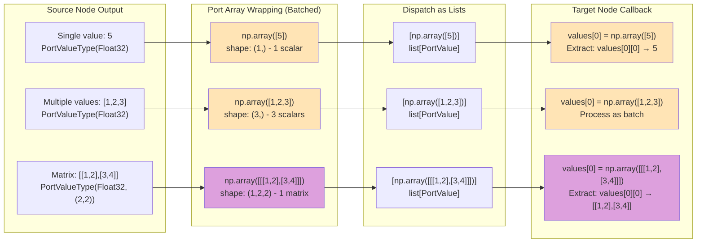
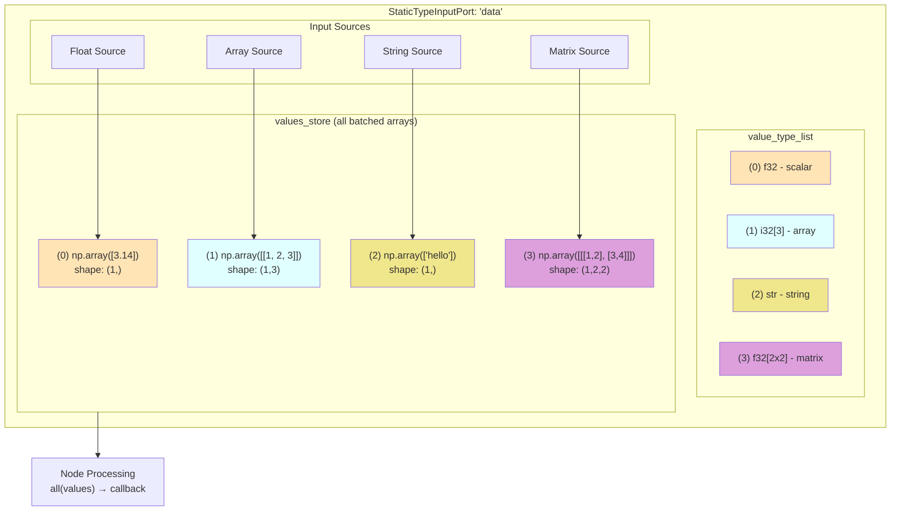
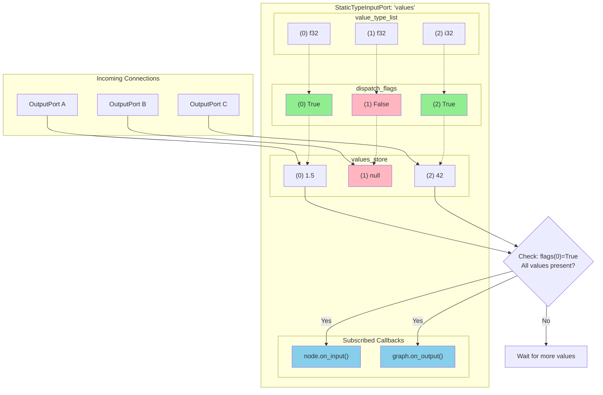
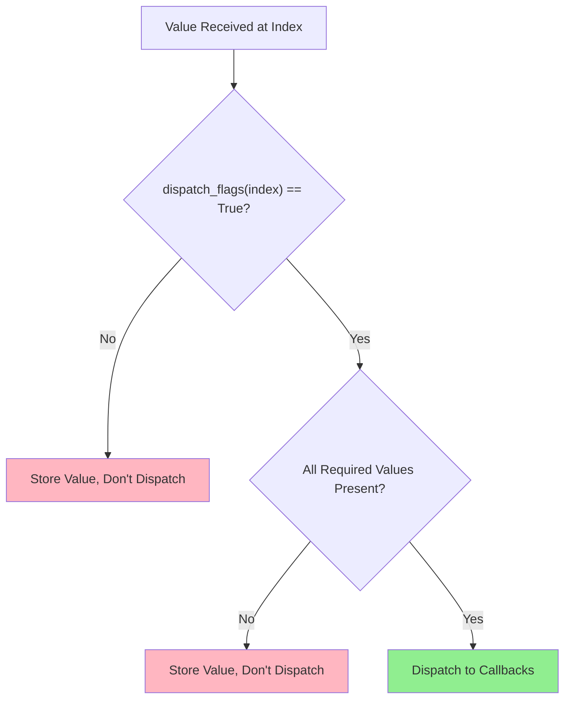
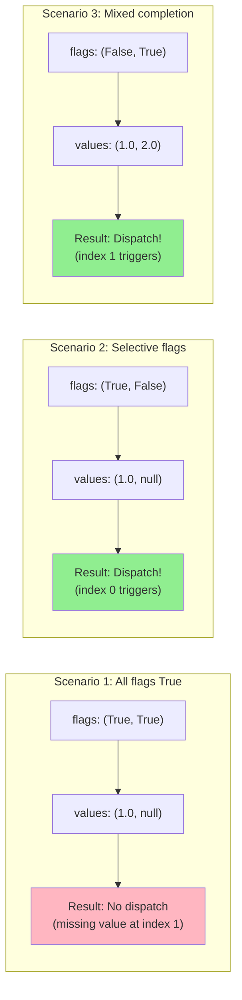

# Port System Specification: Shapes and Dispatch Flags

## Overview

The nonoha-core port system implements a strongly-typed, multidimensional data flow architecture with sophisticated dispatch control mechanisms. **All data flows as arrays**, even single values are wrapped in arrays with one element. This document provides a comprehensive specification of port shapes, array-based data flow, and dispatch flags.

## Fundamental Concept: Array-Based Data Flow

### Core Data Types

```python
# From nonoha_core/port.py
PortValue: TypeAlias = np.ndarray  # All port data is NumPy arrays
PortCallback: TypeAlias = Callable[[list[PortValue]], None]  # Callbacks receive lists of arrays
```

### Everything is an Array

**Critical Understanding**: Even single scalar values flow as arrays:

```python
# Single float value 5.0 flows as:
single_value = np.array([5.0])  # Array with one element

# Dispatched as list containing one array:
output_port.dispatch([single_value])  # list[PortValue] = [np.array([5.0])]

# Received in callback as:
def callback(values: list[PortValue]):
    value = values[0]  # np.array([5.0])
    scalar = values[0][0]  # 5.0 (extract scalar from array)
```

### Array Flow Diagram



**Critical Understanding**: 
- Port arrays always have an extra **batch dimension** as the first axis
- Single matrix `[[1,2],[3,4]]` becomes `[[[1,2],[3,4]]]` with shape `(1,2,2)`
- Multiple matrices can be sent as batch: shape `(5,2,2)` for 5 matrices

## Batch Dimension Concept

### Understanding the Batch Dimension

**All port data includes a batch dimension as the first axis**. This enables sending multiple items of the same type in a single dispatch.

```python
# Data Type: PortValueType(DataType.Float32, (2, 2))  # 2x2 matrix type

# Single matrix dispatch:
matrix = [[1, 2], [3, 4]]  # Shape: (2, 2)
port_array = np.array([matrix])  # Shape: (1, 2, 2) - batch size 1
output.dispatch([port_array])

# Multiple matrices dispatch:
matrices = [
    [[1, 2], [3, 4]], 
    [[5, 6], [7, 8]], 
    [[9, 0], [1, 2]]
]
port_array = np.array(matrices)  # Shape: (3, 2, 2) - batch size 3
output.dispatch([port_array])
```

### Batch Dimension Examples

#### Scalars (Float32)

```python
# Single scalar
output.dispatch([np.array([5.0])])     # Shape: (1,) - 1 scalar

# Multiple scalars
output.dispatch([np.array([1.0, 2.0, 3.0])])  # Shape: (3,) - 3 scalars
```

#### Vectors (Float32, (3,))

```python
# Single 3D vector
vector = [1.0, 2.0, 3.0]
output.dispatch([np.array([vector])])  # Shape: (1, 3) - 1 vector

# Multiple 3D vectors
vectors = [[1, 2, 3], [4, 5, 6], [7, 8, 9]]
output.dispatch([np.array(vectors)])   # Shape: (3, 3) - 3 vectors
```

#### Matrices (Float32, (2, 2))

```python
# Single 2x2 matrix
matrix = [[1, 2], [3, 4]]
output.dispatch([np.array([matrix])])  # Shape: (1, 2, 2) - 1 matrix

# Multiple 2x2 matrices
matrices = [[[1, 2], [3, 4]], [[5, 6], [7, 8]]]
output.dispatch([np.array(matrices)]) # Shape: (2, 2, 2) - 2 matrices
```

#### Images (Float32, (128, 128))

```python
# Single 128x128 image
image = np.random.rand(128, 128)
output.dispatch([np.array([image])])   # Shape: (1, 128, 128) - 1 image

# Batch of 5 images
images = np.random.rand(5, 128, 128)
output.dispatch([images])              # Shape: (5, 128, 128) - 5 images
```

### Processing Batched Data

#### Pattern 1: Extract Single Item

```python
def _on_single_matrix(self, values: list[PortValue]):
    batch = values[0]  # Shape: (1, 2, 2) or (N, 2, 2)
    
    if batch.shape[0] == 1:
        # Extract single matrix
        matrix = batch[0]  # Shape: (2, 2)
        result = self.process_matrix(matrix)
        
        # Dispatch single result (add batch dimension)
        self.output.dispatch([np.array([result])])
```

#### Pattern 2: Process Batch

```python
def _on_batch_matrices(self, values: list[PortValue]):
    batch = values[0]  # Shape: (N, 2, 2)
    
    # Process each matrix in the batch
    results = []
    for matrix in batch:  # Each matrix has shape (2, 2)
        processed = self.process_matrix(matrix)
        results.append(processed)
    
    # Dispatch batch results
    self.output.dispatch([np.array(results)])
```

#### Pattern 3: Batch Operations

```python
def _on_batch_vectors(self, values: list[PortValue]):
    vectors = values[0]  # Shape: (N, 3)
    
    # Vectorized operations on entire batch
    normalized = vectors / np.linalg.norm(vectors, axis=1, keepdims=True)
    
    # Dispatch processed batch
    self.output.dispatch([normalized])
```

### Batch Size Flexibility

**Key Insight**: The same port type can accept any batch size:

```python
# Port definition
port_type = PortValueType(DataType.Float32, (2, 2))  # 2x2 matrix

# All these are valid for the same port:
output.dispatch([np.array([matrix])])        # Shape: (1, 2, 2) - 1 matrix
output.dispatch([np.array([m1, m2])])        # Shape: (2, 2, 2) - 2 matrices  
output.dispatch([np.array([m1, m2, m3, m4])]) # Shape: (4, 2, 2) - 4 matrices
```

### Common Pitfalls

#### Incorrect: Missing Batch Dimension

```python
# WRONG: Dispatching matrix without batch dimension
matrix = [[1, 2], [3, 4]]  # Shape: (2, 2)
output.dispatch([matrix])  # ERROR: Missing batch dimension

# CORRECT: Add batch dimension
output.dispatch([np.array([matrix])])  # Shape: (1, 2, 2)
```

#### Incorrect: Wrong Extraction

```python
def _on_matrix_input(self, values: list[PortValue]):
    # WRONG: Treating batched data as single matrix
    matrix = values[0]  # This is shape (N, 2, 2), not (2, 2)!
    
    # CORRECT: Extract single matrix from batch
    batch = values[0]
    matrix = batch[0]  # Extract first matrix: shape (2, 2)
```

### Variable-Length vs Fixed-Shape Data

#### Variable-Length Data (No Shape Specified)

```python
# Port type definition - no shape constraint
port_type = PortValueType(DataType.Float32)  # Can accept any 1D array

# All these dispatches are valid for the same port type:
output.dispatch([np.array([5])])           # Single value
output.dispatch([np.array([1, 2, 3])])     # Three values 
output.dispatch([np.array([1, 2, 3, 4, 5])]) # Five values

# In receiving callback:
def _on_input(self, values: list[PortValue]):
    data = values[0]  # np.array with variable length
    
    if len(data) == 1:
        scalar = data[0]  # Extract single value
    elif len(data) > 1:
        # Process as sequence
        for value in data:
            self.process_value(value)
```

#### Fixed-Shape Data (Shape Specified)

```python
# Port type definition - fixed shape constraint
matrix_type = PortValueType(DataType.Float32, (2, 2))  # Must be 2x2 matrix

# Only this dispatch pattern is valid:
output.dispatch([np.array([[1, 2], [3, 4]])])  # 2x2 matrix

# This would be invalid:
# output.dispatch([np.array([1, 2, 3, 4])])  # Wrong shape (4,) vs (2,2)

# In receiving callback:
def _on_matrix_input(self, values: list[PortValue]):
    matrix = values[0]  # np.array with guaranteed shape (2, 2)
    # Can safely access matrix[0][1], matrix[1][0], etc.
```

### Practical Examples

#### Example 1: Sensor Data Node (Variable Length)

```python
class SensorDataNode(BaseNode):
    def __init__(self, name: str):
        super().__init__(name, "SensorData")
        
        # Port accepts variable-length float arrays
        output_type = PortValueType(DataType.Float32)  # No shape = variable length
        self._output = StaticTypeOutputPort("readings", [output_type])
        self.outputs["readings"] = self._output
    
    def send_single_reading(self, value: float):
        # Send single value
        self._output.dispatch([np.array([value])])
    
    def send_batch_readings(self, values: list[float]):
        # Send multiple values in one array
        self._output.dispatch([np.array(values)])
```

#### Example 2: Image Processing Node (Fixed Shape)

```python
class ImageProcessorNode(BaseNode):
    def __init__(self, name: str):
        super().__init__(name, "ImageProcessor")
        
        # Port accepts 128x128 grayscale images (batched)
        image_type = PortValueType(DataType.Float32, (128, 128))
        input_port = StaticTypeInputPort("image", [image_type])
        input_port.subscribe(id(self), self._process_image)
        
        self.inputs["image"] = input_port
    
    def _process_image(self, values: list[PortValue]):
        images_batch = values[0]  # Shape: (N, 128, 128) - batch of images
        
        # Process each image in the batch
        filtered_images = []
        for image in images_batch:  # Each image shape: (128, 128)
            filtered = self.apply_filter(image)
            filtered_images.append(filtered)
        
        # Dispatch batch of filtered images
        self.outputs["filtered"].dispatch([np.array(filtered_images)])
```

### Real Implementation Examples

#### Single Value Node (from RealNumberValueNode)

```python
class RealNumberValueNode(BaseNode):
    def __init__(self, name: str):
        super().__init__(name, "RealNumberValue")
        
        # Output port for single float
        output_value = StaticTypeOutputPort("value", [PortValueType(DataType.Float32)])
        self._output_value = output_value
        self.outputs[output_value.name] = output_value
        
        # Set initial value
        default = 0.0
        # IMPORTANT: Single value is wrapped in array!
        self._output_value.dispatch([np.array([default])])
    
    def set_value(self, value: float):
        # Single float becomes array with one element
        self._output_value.dispatch([np.array([value])])
```

#### Array Processing Node (from AddNode)

```python
class AddNode(BaseNode):
    def _on_input_values(self, values: list[PortValue]):
        # values is always list[np.ndarray], even for single inputs
        try:
            out = values[0]  # First array
            for value in values[1:]:  # Iterate through remaining arrays
                out = np.add(out, value)  # NumPy array addition
        except Exception as e:
            logger.warning(f"{self.name}: Error while adding numbers: {e}")
            return
        
        # Dispatch result as list containing one array
        self._output_value.dispatch([out])
```

#### Multi-Array Input (from ComposeNode)

```python
class ComposeNode(BaseNode):
    def _on_input_values(self, values: list[PortValue]):
        # values contains multiple arrays: [arr1, arr2, arr3, ...]
        if not all(isinstance(value, np.ndarray) for value in values):
            return
        
        # Stack arrays along new axis
        try:
            stacked = np.stack(values, axis=0)
            self._output_value.dispatch([stacked])  # Always dispatch as list
        except Exception as e:
            logger.warning(f"{self.name}: Error stacking arrays: {e}")
```

### Array Access Patterns

#### Pattern 1: Single Input Processing

```python
def _on_single_input(self, values: list[PortValue]):
    # Extract the single array from the list
    input_array = values[0]  # np.ndarray
    
    # For scalar values:
    if input_array.shape == (1,):
        scalar_value = input_array[0]  # Extract scalar from array
    
    # For multi-dimensional arrays:
    elif input_array.ndim > 1:
        processed = self.process_matrix(input_array)
    
    # Always dispatch as list of arrays
    self._output.dispatch([processed_result])
```

#### Pattern 2: Multiple Input Processing

```python
def _on_multiple_inputs(self, values: list[PortValue]):
    # values = [np.array([x]), np.array([y]), np.array([z])]
    
    # Extract scalars from each array
    x = values[0][0]  # First array, first element
    y = values[1][0]  # Second array, first element
    z = values[2][0]  # Third array, first element
    
    # Process and create result array
    result = np.array([x + y + z])
    
    # Dispatch as list
    self._output.dispatch([result])
```

#### Pattern 3: Array List Processing

```python
def _on_array_list(self, values: list[PortValue]):
    # values = [array1, array2, array3, ...]
    # Each element is already a numpy array
    
    # Process each array in the list
    processed_arrays = []
    for array in values:
        processed = self.transform(array)
        processed_arrays.append(processed)
    
    # Option 1: Dispatch all arrays
    self._output.dispatch(processed_arrays)
    
    # Option 2: Combine and dispatch single result
    combined = np.concatenate(processed_arrays)
    self._output.dispatch([combined])
```

## Port Shape Concept

### What are Port Shapes?

Port shapes define the **multidimensional structure** of data flowing through ports. They combine primitive data types with dimensional information to create type-safe data channels.

### PortValueType Structure

```python
class PortValueType:
    def __init__(self, data_type: DataType, shape: tuple[int, ...] = ()):
        self.data_type = data_type  # DataType enum (Float32, Int8, Bool, String, etc.)
        self.shape = shape          # Dimensional structure tuple
        self.ndim = len(shape)      # Number of dimensions
        self.name = f"{data_type_name}{shape_string}"  # Human-readable name
```

### Shape Examples

```python
# Variable-length data (no shape constraint)
PortValueType(DataType.Float32)           # "f32" - can hold [5] or [1,2,3] or [1,2,3,4,5]
PortValueType(DataType.Int32)             # "i32" - can hold [10] or [1,2,3,4]
PortValueType(DataType.String)            # "str" - can hold ["hello"] or ["a","b","c"]

# Fixed-size 1-dimensional arrays
PortValueType(DataType.Float32, (3,))     # "f32[3]" - must be exactly 3 floats: [1,2,3]
PortValueType(DataType.Bool, (5,))        # "bool[5]" - must be exactly 5 booleans

# Fixed-size 2-dimensional arrays
PortValueType(DataType.Float32, (3, 2))   # "f32[3x2]" - must be 3 rows, 2 columns
PortValueType(DataType.Int32, (4, 4))     # "i32[4x4]" - must be 4x4 matrix

# Variable-size dimensions (-1 indicates "any size")
PortValueType(DataType.Float32, (-1,))    # "f32[N]" - 1D array of any length
PortValueType(DataType.Float32, (3, -1))  # "f32[3xN]" - 3 rows, any number of columns
```

**Key Distinction**:
- `PortValueType(DataType.Float32)` → **Variable length**: `[5]`, `[1,2,3]`, `[1,2,3,4,5]` all valid
- `PortValueType(DataType.Float32, (3,))` → **Fixed length**: Only `[a,b,c]` format valid

### Shape Validation Rules

When connecting ports, shapes must be **compatible** according to these rules:

```python
def port_value_type_can_cast(from_type: PortValueType, to_type: PortValueType) -> bool:
    # 1. "Any" type accepts everything
    if to_type.data_type == DataType.Any:
        return True
    
    # 2. Dimensions must match
    if from_type.ndim != to_type.ndim:
        return False
    
    # 3. Each dimension must match or target can be -1 (any size)
    for from_dim, to_dim in zip(from_type.shape, to_type.shape):
        if from_dim != to_dim and to_dim != -1:
            return False
    
    # 4. Data types must be castable according to promotion table
    return DATA_TYPE_CAST_TABLE[from_type.data_type][to_type.data_type] == 1
```

**Valid Connections:**

- `f32[3]` → `f32[3]` ✅ (exact match)
- `f32[3]` → `f32[N]` ✅ (variable size accepts fixed)
- `i32[2x2]` → `f32[2x2]` ✅ (int32 promotes to float32)
- `f32[3]` → `Any` ✅ (Any accepts everything)

**Invalid Connections:**

- `f32[3]` → `f32[4]` ❌ (size mismatch)
- `f32[3]` → `f32[3x1]` ❌ (dimension mismatch)
- `f32` → `i32` ❌ (no float to int demotion)

## Multi-Value Port System

### Multiple Values in a Single Port

nonoha-core ports can handle **multiple values of different types** within a single port through the `value_type_list` mechanism. **Each value is still an array**, even if it represents a single scalar.

```python
# Example: Port accepting multiple different types (all as arrays)
value_types = [
    PortValueType(DataType.Float32),      # Index 0: np.array([scalar])
    PortValueType(DataType.Int32, (3,)),  # Index 1: np.array([x, y, z])
    PortValueType(DataType.String),       # Index 2: np.array(['text'])
]

input_port = StaticTypeInputPort("multi_input", value_types)

# When all values are received, callback gets:
# values = [
#     np.array([5.0]),        # Scalar wrapped in array
#     np.array([1, 2, 3]),    # 3-element array
#     np.array(['hello'])     # String wrapped in array
# ]
```

### Multi-Value Port Structure



### Use Cases for Multi-Value Ports

#### 1. Heterogeneous Data Processing

```python
class DataProcessorNode(BaseNode):
    def __init__(self, name: str):
        super().__init__(name, "DataProcessor")
        
        # Accept different types of input data
        input_types = [
            PortValueType(DataType.Float32, (-1,)),  # Sensor data array
            PortValueType(DataType.String),          # Device name
            PortValueType(DataType.Int32),           # Timestamp
            PortValueType(DataType.Bool),            # Status flag
        ]
        
        input_port = StaticTypeInputPort("sensor_data", input_types)
        input_port.subscribe(id(self), self._process_sensor_data)
        
        self.inputs["sensor_data"] = input_port
        
    def _process_sensor_data(self, values: list[PortValue]):
        # Remember: ALL values are arrays!
        sensor_values = values[0]    # np.ndarray - sensor readings array
        device_name = values[1][0]   # Extract string from np.array(['device_name'])
        timestamp = values[2][0]     # Extract int from np.array([timestamp])
        is_active = values[3][0]     # Extract bool from np.array([True/False])
        
        if is_active:
            processed = self.analyze_sensor_data(sensor_values, device_name, timestamp)
            # Result must be wrapped in array and dispatched as list
            self.outputs["result"].dispatch([np.array([processed])])
```

#### 2. Mathematical Operations with Metadata

```python
class MathWithMetadataNode(BaseNode):
    def __init__(self, name: str):
        super().__init__(name, "MathWithMetadata")
        
        # Multiple mathematical inputs with different shapes
        input_types = [
            PortValueType(DataType.Float32, (3, 3)),  # 3x3 matrix
            PortValueType(DataType.Float32, (3,)),    # 3D vector
            PortValueType(DataType.String),           # Operation type
            PortValueType(DataType.Float32),          # Scale factor
        ]
        
        math_input = StaticTypeInputPort("math_input", input_types)
        math_input.subscribe(id(self), self._compute)
        
        self.inputs["math_input"] = math_input
        
    def _compute(self, values: list[PortValue]):
        # All inputs are batched arrays
        matrix_batch = values[0]   # Shape: (1, 3, 3) - single 3x3 matrix
        vector_batch = values[1]   # Shape: (1, 3) - single 3D vector
        operation = values[2][0]   # Extract string from batch
        scale = values[3][0]       # Extract scalar from batch
        
        # Extract single items from batches
        matrix = matrix_batch[0]   # Shape: (3, 3)
        vector = vector_batch[0]   # Shape: (3,)
        
        if operation == "transform":
            result = (matrix @ vector) * scale
        elif operation == "multiply":
            result = matrix * scale
        
        # Dispatch result with batch dimension
        self.outputs["result"].dispatch([np.array([result])])
```

#### 3. Configuration and Data Combination

```python
class ConfigurableFilterNode(BaseNode):
    def __init__(self, name: str):
        super().__init__(name, "ConfigurableFilter")
        
        # Combine data with configuration parameters
        input_types = [
            PortValueType(DataType.Float32, (-1,)),  # Data to filter
            PortValueType(DataType.Float32),         # Cutoff frequency
            PortValueType(DataType.Int32),           # Filter order
            PortValueType(DataType.String),          # Filter type ("low", "high", "band")
        ]
        
        filter_input = StaticTypeInputPort("filter_config", input_types)
        filter_input.subscribe(id(self), self._apply_filter)
        
        self.inputs["filter_config"] = filter_input
        
    def _apply_filter(self, values: list[PortValue]):
        # Extract values from arrays
        data = values[0]             # np.ndarray - signal data array
        cutoff = values[1][0]        # Extract scalar from array
        order = values[2][0]         # Extract int from array
        filter_type = values[3][0]   # Extract string from array
        
        filtered_data = self.apply_digital_filter(data, cutoff, order, filter_type)
        # Result is already an array, dispatch as list
        self.outputs["filtered"].dispatch([filtered_data])
```

### Connection Patterns

#### Full Multi-Value Connection

```python
# Connect all values from output to input
graph.connect_nodes(
    output_node="data_source",
    output_port="multi_output",    # Provides [f32, i32[3], str]
    input_node="processor",
    input_port="multi_input"       # Expects [f32, i32[3], str]
)
```

#### Selective Value Connection (Indexed)

```python
# Connect only specific values by index
graph.connect_nodes(
    output_node="matrix_source",
    output_port="matrix",          # Single f32[3x3] output
    input_node="processor", 
    input_port="multi_input",
    input_port_index=0             # Connect to first slot only
)

graph.connect_nodes(
    output_node="string_source",
    output_port="text",            # Single string output
    input_node="processor",
    input_port="multi_input",
    input_port_index=2             # Connect to third slot (string)
)
```

### Multi-Value Output Ports

Output ports can also provide multiple values:

```python
class DataDecomposerNode(BaseNode):
    def __init__(self, name: str):
        super().__init__(name, "DataDecomposer")
        
        # Single input with complex data
        input_data = StaticTypeInputPort("complex_data", [
            PortValueType(DataType.Float32, (-1, 3))  # Nx3 matrix
        ])
        
        # Multiple output types
        output_types = [
            PortValueType(DataType.Float32, (-1,)),   # X coordinates
            PortValueType(DataType.Float32, (-1,)),   # Y coordinates  
            PortValueType(DataType.Float32, (-1,)),   # Z coordinates
            PortValueType(DataType.Int32),            # Point count
        ]
        
        multi_output = StaticTypeOutputPort("decomposed", output_types)
        
        input_data.subscribe(id(self), self._decompose)
        self.inputs["complex_data"] = input_data
        self.outputs["decomposed"] = multi_output
        
    def _decompose(self, values: list):
        points = values[0]  # Nx3 matrix
        
        x_coords = points[:, 0]  # Extract X column
        y_coords = points[:, 1]  # Extract Y column
        z_coords = points[:, 2]  # Extract Z column
        count = len(points)      # Point count
        
        # Dispatch multiple values as a list
        self.outputs["decomposed"].dispatch([x_coords, y_coords, z_coords, count])
```

### Best Practices for Multi-Value Ports

#### 1. Clear Documentation

```python
class MultiValueNode(BaseNode):
    """
    Multi-value input port 'data' expects:
    - [0] f32[N]: Sensor readings array
    - [1] str: Device identifier  
    - [2] i32: Unix timestamp
    - [3] bool: Calibration status
    """
    def __init__(self, name: str):
        # Implementation with clear value expectations
        pass
```

#### 2. Validation

```python
def _on_multi_input(self, values: list):
    # Validate all expected values are present
    if len(values) != 4:
        print(f"Expected 4 values, got {len(values)}")
        return
    
    # Validate specific types and shapes
    if values[0].shape[0] == 0:
        print("Empty sensor data array")
        return
    
    if not isinstance(values[1], str):
        print("Device name must be string")
        return
    
    # Process validated data
    self.process_data(values)
```

#### 3. Flexible Value Handling

```python
def _handle_optional_values(self, values: list):
    # Handle cases where some values might be None
    sensor_data = values[0] if values[0] is not None else np.array([])
    device_name = values[1] if values[1] is not None else "unknown"
    timestamp = values[2] if values[2] is not None else 0
    
    # Process with defaults for missing values
    self.process_with_defaults(sensor_data, device_name, timestamp)
```

## Dispatch Flags System

### What are Dispatch Flags?

`dispatch_flags` is a boolean array in `StaticTypeInputPort` that controls **when the port triggers its callbacks**. Each flag corresponds to one value slot in the port's `value_type_list`.

```python
class StaticTypeInputPort:
    def __init__(self, name: str, value_type_list: list[PortValueType]):
        self.value_type_list = value_type_list
        self.dispatch_flags: list[bool] = [False] * len(value_type_list)
        # values_store contains np.ndarray objects (or None)
        self.values_store: list[PortValue | None] = [None] * len(value_type_list)
```

### Input Port Conceptual Structure



**Key Points:**

- **Green flags (True)**: Receiving values at these indices can trigger dispatch
- **Red flags (False)**: Values at these indices won't trigger dispatch
- **Dispatch only occurs when**: A flagged index receives a value AND all required values are present
- **In this example**: Values at index 0 or 2 can trigger, but index 1 is "passive"

### How Dispatch Flags Work



### Dispatch Logic

```python
def receive_value_with_index(self, index: int, values: list[PortValue]):
    # Store the received array (values[0] is np.ndarray)
    self.values_store[index] = values[0]  # Store the first array from input
    
    # Only dispatch if this index has dispatch flag AND all required values are present
    if self.dispatch_flags[index] and all(value is not None for value in self.values_store):
        # Dispatch list of arrays to callbacks
        self.dispatch(self.values_store)  # self.values_store is list[PortValue]
```

### Dispatch Scenarios



### Connection Types and Dispatch Behavior

#### 1. Full Port Connection

```python
# Connect entire output port to entire input port
graph.connect_nodes(
    output_node="source", output_port="data",
    input_node="target", input_port="input"
)

# Behavior:
# - All dispatch_flags set to [True, True, ...]
# - Dispatches when all input values are received
# - Most common connection type
```

#### 2. Indexed Connection

```python
# Connect to specific index of multi-value input port
# Conceptual syntax: target_port.values[0] = source_port
graph.connect_nodes(
    output_node="source", output_port="data",
    input_node="target", input_port="input",
    input_port_index=0  # Connect to first value slot
)

# Behavior:
# - Only dispatch_flags[0] set to True
# - Dispatches when specific indexed value is received
# - Allows selective triggering
```

## Practical Examples

### Example 1: Vector Math Node

```python
class VectorAddNode(BaseNode):
    def __init__(self, name: str):
        super().__init__(name, "VectorAdd")
        
        # Two vector inputs of any size
        vector_type = PortValueType(DataType.Float32, (-1,))  # f32[N]
        
        input_values = StaticTypeInputPort("vectors", [vector_type, vector_type])
        input_values.subscribe(id(self), self._on_vectors)
        
        output_result = StaticTypeOutputPort("result", [vector_type])
        
        # Register ports
        self.inputs["vectors"] = input_values
        self.outputs["result"] = output_result
    
    def _on_vectors(self, values: list):
        # Vectors must have same length for addition
        if values[0].shape != values[1].shape:
            print(f"Shape mismatch: {values[0].shape} vs {values[1].shape}")
            return
        
        result = values[0] + values[1]
        self.outputs["result"].dispatch([result])
```

### Example 2: Matrix Decomposition Node

```python
class MatrixDecomposeNode(BaseNode):
    def __init__(self, name: str):
        super().__init__(name, "MatrixDecompose")
        
        # Input: 2D matrix of any size
        matrix_type = PortValueType(DataType.Float32, (-1, -1))  # f32[NxM]
        
        # Outputs: individual vectors for each row
        vector_type = PortValueType(DataType.Float32, (-1,))     # f32[N]
        
        input_matrix = StaticTypeInputPort("matrix", [matrix_type])
        input_matrix.subscribe(id(self), self._on_matrix)
        
        # Dynamic outputs created based on input matrix size
        self.inputs["matrix"] = input_matrix
        self._output_rows = None
    
    def _on_matrix(self, values: list):
        matrix = values[0]  # Shape: (rows, cols)
        
        # Create output ports for each row if needed
        if self._output_rows is None or len(self._output_rows) != matrix.shape[0]:
            self._create_row_outputs(matrix.shape[0])
        
        # Dispatch each row to its corresponding output
        for i, row in enumerate(matrix):
            self._output_rows[i].dispatch([row])
    
    def _create_row_outputs(self, num_rows: int):
        self._output_rows = []
        vector_type = PortValueType(DataType.Float32, (-1,))
        
        for i in range(num_rows):
            output_port = StaticTypeOutputPort(f"row_{i}", [vector_type])
            self.outputs[f"row_{i}"] = output_port
            self._output_rows.append(output_port)
```

### Example 3: Selective Trigger Node

```python
class SelectiveTriggerNode(BaseNode):
    def __init__(self, name: str):
        super().__init__(name, "SelectiveTrigger")
        
        # Three inputs, but only trigger on specific ones
        float_type = PortValueType(DataType.Float32)
        
        input_values = StaticTypeInputPort("values", [float_type, float_type, float_type])
        
        # Custom dispatch control
        input_values.dispatch_flags = [True, False, True]  # Only index 0 and 2 trigger
        input_values.subscribe(id(self), self._on_selective_input)
        
        self.inputs["values"] = input_values
        self.outputs["result"] = StaticTypeOutputPort("result", [float_type])
    
    def _on_selective_input(self, values: list):
        # This only gets called when values[0] or values[2] are received
        # values[1] can be updated without triggering this callback
        
        if values[0] is not None and values[2] is not None:
            result = values[0] * values[2]  # Multiply first and third values
            self.outputs["result"].dispatch([result])
```

## Advanced Patterns

### Dynamic Shape Inference

```python
class DynamicReshapeNode(BaseNode):
    def _on_input_data(self, values: list):
        input_array = values[0]  # Input shape: f32[N]
        target_shape = values[1] # Target shape: i32[2] -> [rows, cols]
        
        # Validate reshape is possible
        if np.prod(input_array.shape) != np.prod(target_shape):
            print("Cannot reshape: size mismatch")
            return
        
        # Reshape and update output port type
        reshaped = input_array.reshape(target_shape)
        
        # Update output port type to match new shape
        new_type = PortValueType(DataType.Float32, tuple(target_shape))
        self.outputs["reshaped"].value_type_list = [new_type]
        
        self.outputs["reshaped"].dispatch([reshaped])
```

### Broadcasting Compatibility

```python
def check_broadcast_compatibility(shape1: tuple, shape2: tuple) -> bool:
    """Check if two shapes can be broadcast together (NumPy rules)"""
    # Pad shorter shape with 1s on the left
    max_len = max(len(shape1), len(shape2))
    padded1 = (1,) * (max_len - len(shape1)) + shape1
    padded2 = (1,) * (max_len - len(shape2)) + shape2
    
    # Check compatibility dimension by dimension
    for dim1, dim2 in zip(padded1, padded2):
        if dim1 != dim2 and dim1 != 1 and dim2 != 1 and dim1 != -1 and dim2 != -1:
            return False
    
    return True

# Usage in broadcasting node
class BroadcastAddNode(BaseNode):
    def _on_inputs(self, values: list):
        if not check_broadcast_compatibility(values[0].shape, values[1].shape):
            print("Shapes not broadcast compatible")
            return
        
        result = values[0] + values[1]  # NumPy handles broadcasting
        self.outputs["result"].dispatch([result])
```

## Best Practices

### 1. Shape Design Guidelines

- **Use specific shapes when possible**: `f32[3]` is better than `f32[N]` if you always expect 3 elements
- **Use -1 for variable dimensions judiciously**: Only use when you truly need variable sizes
- **Consider broadcasting**: Design shapes that work well with NumPy broadcasting rules
- **Document shape contracts**: Clearly specify what each shape dimension represents

### 2. Dispatch Flag Usage

```python
# Good: Clear intent for selective triggering
class ConditionalProcessor(BaseNode):
    def __init__(self, name: str):
        super().__init__(name, "ConditionalProcessor")
        
        # Only trigger when condition changes, not when data changes
        input_port = StaticTypeInputPort("inputs", [data_type, condition_type])
        input_port.dispatch_flags = [False, True]  # Only condition triggers
        
# Avoid: Complex dispatch flag logic that's hard to understand
# dispatch_flags = [True, False, True, False, True]  # Unclear pattern
```

### 3. Error Handling

```python
class RobustNode(BaseNode):
    def _on_input(self, values: list):
        try:
            # Validate shapes
            if values[0].shape != (3,):
                raise ValueError(f"Expected shape (3,), got {values[0].shape}")
            
            # Process data
            result = self.process(values[0])
            
            # Validate output shape
            if result.shape != self.expected_output_shape:
                raise ValueError(f"Output shape mismatch: {result.shape}")
            
            self.outputs["result"].dispatch([result])
            
        except Exception as e:
            print(f"{self.name}: Error processing data: {e}")
            # Optionally dispatch error signal or default value
```

## Conclusion

The nonoha-core port system provides a robust foundation for type-safe, multidimensional data flow with fine-grained execution control. Understanding shapes and dispatch flags is crucial for building efficient and reliable node-based applications.

Key takeaways:

- **Array-based data flow**: All values flow as NumPy arrays, even single scalars
- **Uniform dispatch interface**: All callbacks receive `list[PortValue]` consistently
- **Shapes ensure type safety** and enable compile-time validation
- **Dispatch flags provide selective triggering** for advanced control flow
- **The system balances flexibility with safety** through variable dimensions and "Any" types
- **Proper design patterns** lead to maintainable and debuggable node graphs

### Critical Implementation Rules

1. **Always include batch dimension**: `output.dispatch([np.array([data])])` for single items
2. **Extract from batches**: `item = values[0][0]` to get first item from batch
3. **Handle batch arrays**: `batch = values[0]` gives you shape `(N, ...)`
4. **Dispatch as lists**: Even single results must be `dispatch([result])`
5. **Remember the extra dimension**: Matrix `(2,2)` becomes port array `(1,2,2)`
